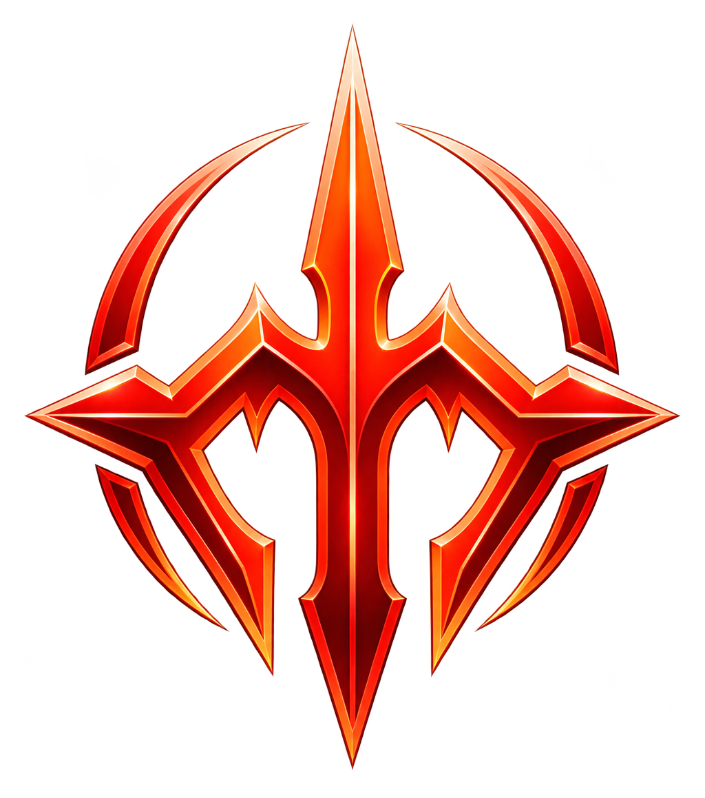
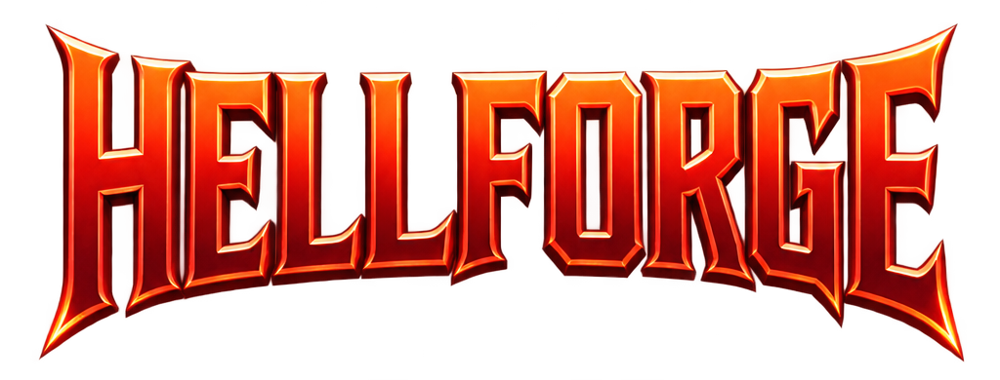

<div align="center">
  
  <br />
  
  <p><strong>Увесь твій DOOM — в одному лаунчері.</strong></p>
  <p>Сучасний лаунчер для Windows: класичні ігри DOOM, моди, мапи та власні збірки.</p>
  <p><a href="README.md">English</a> · <strong>Українська</strong></p>
  <p>   </p>
</div>

---

## Про проєкт

**Hellforge** об'єднує твою колекцію класичних DOOM-ігор в одному сучасному лаунчері. Організовуй IWAD-файли, модифікації, мапи й власні збірки та запускай їх через встановлений рушій.

## Можливості

- **Бібліотека ігор:** додавання власних IWAD-файлів і впорядкування класичних ігор.
- **Моди та мапи:** окремі бібліотеки для WAD, PK3, PK7 і ZIP; перейменування записів без зміни назв файлів на диску.
- **Власні збірки:** поєднуй гру, рушій, мапи та моди, керуй порядком завантаження й змінюй обкладинки.
- **Рушії:** налаштовуй установлений GZDoom або обирай власний виконуваний файл.
- **Інтеграція OBSIDIAN:** генеруй випадкові мапи DOOM за допомогою окремо встановленого OBSIDIAN v20.
- **Статистика лаунчера:** кількість запусків, час гри, історія запусків і ручне позначення пройдених збірок. Без відстеження подій усередині гри.
- **Персоналізація:** сім тем інтерфейсу, групи збірок і вибір із 23 мов.
- **Локальна бібліотека:** SQLite та інструменти резервного копіювання метаданих і налаштувань.

## Як почати

> **Реліз для Windows:** посилання на інсталятор з'явиться тут після збирання та перевірки релізної версії.

1. Встанови сумісний рушій DOOM, наприклад [GZDoom](https://zdoom.org/downloads).
2. Підготуй власний легально отриманий IWAD-файл гри (наприклад, `DOOM2.WAD`).
3. Додай у Hellforge виконуваний файл рушія та імпортуй IWAD.
4. За бажанням імпортуй моди й мапи.
5. Створи збірку, налаштуй порядок завантаження та натисни **Грати**.

Hellforge **не містить** комерційних файлів ігор DOOM.

## Збірка з вихідного коду

Потрібні: Windows, Node.js LTS, Rust із MSVC toolchain, Microsoft C++ Build Tools та WebView2 runtime.

```powershell
npm install
npm run tauri dev
```

Для створення релізної Windows-збірки:

```powershell
npm run tauri build
```

Також можна скористатися `Build_Hellforge.bat` у корені проєкту. Після тестування готові файли з'являться у [GitHub Releases](https://github.com/Steenuga/Hellforge/releases).

## Мови

Українська, англійська, польська, німецька, французька, іспанська, японська, китайська (спрощена), чеська, словацька, болгарська, хорватська, сербська, білоруська, румунська, литовська, латиська, естонська, грузинська, казахська, узбецька, азербайджанська та вірменська.

Переклади можна покращувати спільнотою. Якщо знайшов неточність, створи issue або надішли pull request.

## Технології

- [Tauri 2](https://tauri.app/) та **Rust** — десктопна частина
- **React** і **TypeScript** — інтерфейс
- **SQLite** — дані бібліотеки

## Зворотний зв'язок і внесок у проєкт

Знайшов помилку, неточність перекладу або незручний елемент інтерфейсу? Напиши в [Issues](https://github.com/Steenuga/Hellforge/issues). Пропозиції та pull request вітаються.

## Правова інформація

Hellforge — незалежний проєкт спільноти, не пов'язаний з id Software, Bethesda чи ZeniMax. DOOM та пов'язані торговельні марки належать їхнім власникам. Файли ігор і зовнішні інструменти користувач встановлює самостійно.

## Ліцензія

Проєкт розповсюджується за [ліцензією MIT](LICENSE).
